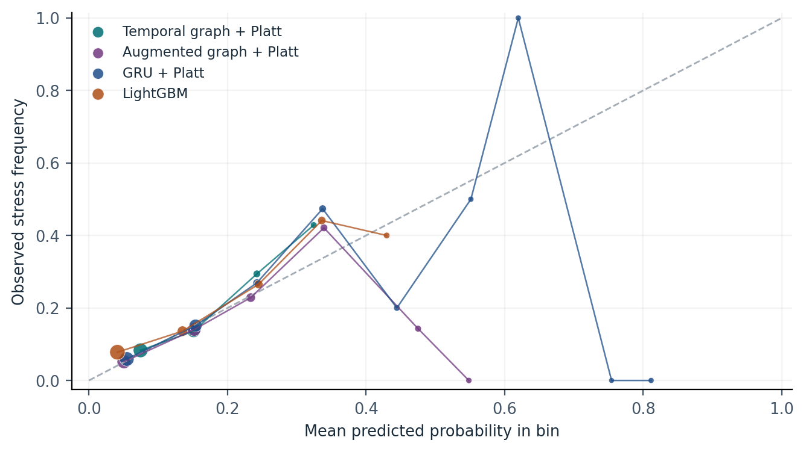
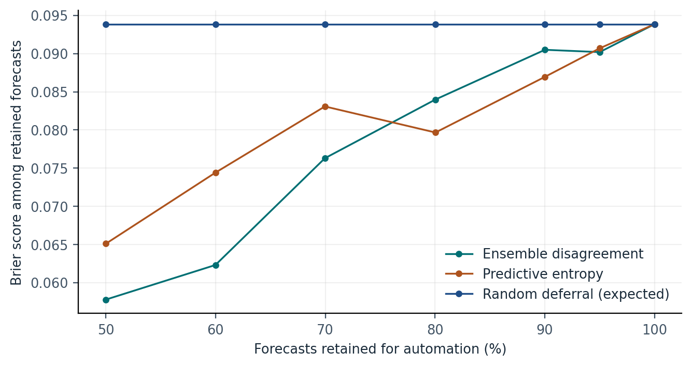
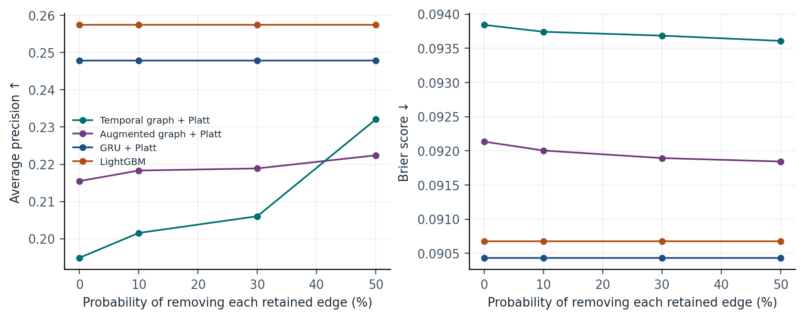
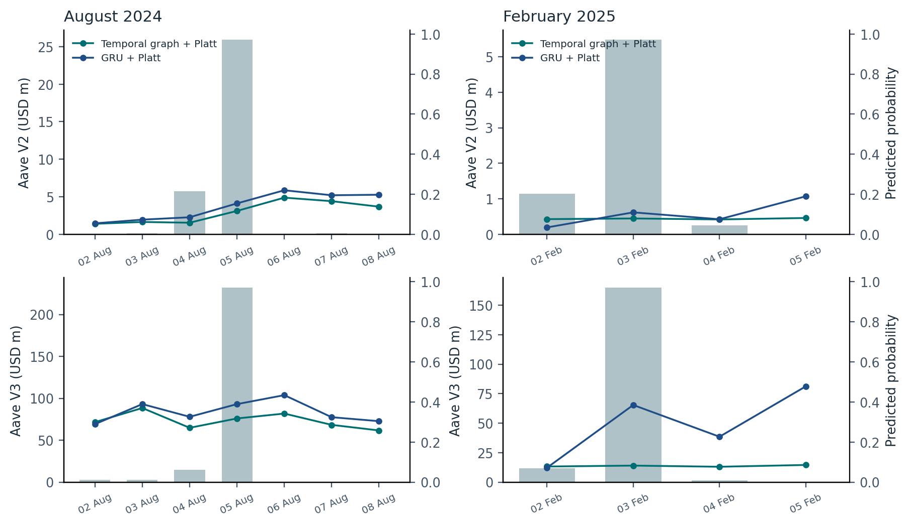

# Introduction

Lending protocols such as Aave give observers an unusually detailed view of financial distress. Collateral, debt and most changes to a position can be reconstructed from a ledger. That visibility does not make the timing or aggregate size of liquidations obvious. Borrowers can add collateral or reduce their debt before an account becomes eligible. A price update can put multiple positions below their liquidation threshold at once. The timing and execution of liquidations also depend on the liquidity available to liquidators and the cost of transacting [@qin2021; @schuler2026]. A protocol dashboard that reports liquidation volume is therefore answering a different question from a monitoring system that must decide, before the next observation interval, whether an unusually large volume is likely.

The distinction is consequential when a warning enters a risk-governance workflow. A risk analyst can use an estimate of tomorrow's liquidation pressure to decide which markets to inspect, verify whether a price input is stale, or commission a position-level exposure assessment. Each action consumes attention. A system that sends more warnings on all high-volatility days can catch additional events while overloading that workflow. A second output for uncertainty is useful only if it improves routing under the same operational constraints. A model's ability to rank cases, its ability to assign calibrated probabilities and the behaviour of a review queue are separate empirical quantities.

Aave is also part of an ecosystem in which tokens issued by one protocol can be held or accepted elsewhere. Fixed-income intuition suggests that counterparty information might contribute to warnings after accounting for common market factors. The observable network in DeFi is different from a bilateral debt ledger. DeXposure links protocol holdings and issuing protocols using the composition of total value locked (TVL) [@wu2025]. Its weights contain information about token-mediated dependencies and are partly sensitive to valuations. Changes can therefore reflect prices, portfolio composition, data coverage and evolving links. The study asks whether these measurements contain incremental information for a realised outcome measured from liquidation events.

The main experiment issues a prediction at each UTC midnight. A weekly global graph enters with a conservative assumed reporting lag. The forecast target is the source-reported USD value liquidated during the following 24 hours, converted to an indicator using only a training-period threshold for the corresponding market version. Oracle-price observations are taken from their actual update times. The design joins the graph to Ethereum outcomes at the version level. This permits a direct operational test of the graph as it is published, subject to a known geographic mismatch between covariate and target.

The study has four components. It first compares a directed, time-varying graph encoder with models using the same local and oracle inputs, including a recurrent model and boosted trees. It then holds the test period apart from calibration and quantifies differences in proper scores and event ranking. It challenges the same fitted models with reporting delays and missing links, with an augmented graph model trained against an additional observation regime. Finally, it follows the consequences of the forecast through two threshold rules and two documented episodes of stress. A weighted lagged association probes whether the measured link between the two labelled versions helps after including the other version's prior liquidation volume.

# Related work

## Liquidation, liquidity and propagation

Existing on-chain studies distinguish the mechanics of liquidation from later consequences for asset markets. @qin2021 compare liquidation designs across major Ethereum lending platforms and document differences in financial incentives and outcomes for borrowers. @lehar2022 connect collateral liquidations to subsequent trading and asset-price pressure. Their identification uses trades around actual liquidation events and multiple trading venues. The mechanism is economically important for the present work. It also illustrates the additional data required to show that a price effect or liquidation in one market caused another event. A lagged coefficient on a TVL-based link does not identify the financial feedback mechanism they study.

@chiu2026 use Aave V3 transaction data to describe recurring leverage and the concentration of liquidations into waves. They also report limited impacts on broader markets in their sample. Those findings motivate measuring the timing and concentration of liquidation volume while leaving general equilibrium effects outside the estimand. @schuler2026 studies the transition from a position's eligibility for liquidation to successful execution, using block-level observations in Aave V2. Here the prediction unit is a market version and a day, with the influence of position-level frictions aggregated into the realised outcome. Work on monetary-policy transmission to stablecoin deposit rates documents another source of DeFi financial dynamics (@barbon2026). Its interest-rate transmission question differs from this study's short-horizon liquidation outcome. Here we evaluate realised liquidation events and measure forecast deterioration when graph and oracle observations arrive late.

Related work on local-currency DeFi governance studies bounded risk-parameter adjustments under oracle latency and market stress (@rokni2026governance). Unlike that counterfactual controller study, the present work evaluates the empirical quality and timing of observable warning inputs; no governance-policy welfare improvement is inferred from the forecasts alone.

## Financial networks as forecasting inputs

DeXposure reconstructs token-mediated holdings from protocol-level TVL composition. Its published benchmarks include network clustering, sector responses around Terra and FTX, and dynamic link prediction [@wu2025]. DeXposure-FM predicts changes in protocol flows and the topology and weights of links. It then derives concentration and spillover measures for stress analysis [@shu2026]. Those tasks explain how a network evolves. A liquidation-warning model uses the network as an input and is evaluated on a separate outcome from the lending event record. The distinction matters because a model can describe network structure well while providing little information about the next liquidation wave conditional on prices.

A GraphSAGE-style encoder can aggregate neighbour features with learned transformations and shared parameters [@hamilton2017]. The model here uses separate transforms for the two edge directions and an explicit exposure weight. It restricts aggregation to an ego network around each focal protocol version. The history model is a gated recurrent unit (GRU) [@cho2014]. This size suits a benchmark with two labelled entities. A version of the same network with fixed topology tests whether time-varying links add information beyond the temporal variation of node attributes. Models using only network summaries help diagnose whether any observed gain requires learned neighbour aggregation.

## Calibration and decisions under incomplete information

The Brier score and log loss evaluate whether a forecast puts adequate probability on the observed outcome [@gneiting2007]. With a rare outcome, average precision makes clear how many false positives enter the upper tail of a ranking [@saito2015]. Those scores need not favour the same model. In the benchmark a probability calibrator may improve proper scores while preserving most within-fold ranks. It can change pooled ranks across folds because each fold fits its own calibration function. Reliability diagrams are reported with frequencies and sample sizes because high-probability bins often contain few cases.

Deep ensembles provide an empirical spread over models trained with different initialisations and data orders [@lakshminarayanan2017]. Calibration on familiar data and reliability under distribution shift are different properties [@guo2017; @ovadia2019]. The test treats the variance of ensemble scores as a candidate ranking of uncertainty. It cannot measure all the sources of risk, including unexpected new collateral behaviour or a systematic error shared by all members. Selective prediction evaluates a review rule by the observed loss on retained cases and the fraction covered [@geifman2017]. For liquidation monitoring it is also important to count what the uncertainty rule defers. A lower conditional loss can result simply from concentrating manual review on many of the event days.

# Cohort, data and information timing

## Ethereum outcomes and graph matching

The empirical unit is a version-day for Aave V2 or V3 on Ethereum in the Chaffard archive [@chaffard2026]. The public release has two event tables and paired hourly aggregate tables, with separate hourly reserve series. The V3 Core launch on 27 January 2023 is documented in the executed Aave governance proposal [@aave2023]. The V3 USDT reserve series begins on 13 February 2023. Forecast origins start on 1 March 2023 to provide history after both versions and all four reserve series enter the source. The last forecast origin is 24 August 2025, corresponding to the end of the common graph evaluation calendar. This period includes 1,816 version-days before defining train, development and test windows. The estimation history precedes the first scored origin by thirteen months.

The graph is the pinned weekly Git LFS file from the DeXposure repository [@wu2025]. Its 283 releases are dated Mondays from 23 March 2020 to 18 August 2025. The mapping file identifies AAVE V2 as node 111 and AAVE V3 as node 1599. Each event table uses the source publisher's Ethereum and Aave version tags. The link is an exact match of the version names but a coarser match than an Ethereum pool or reserve address. The retained graph includes DeXposure protocol identifiers only. Unmapped token-only nodes, nonpositive weights and self-links are discarded. Repeated directed pairs are summed within the same snapshot. The extractor retains 136 weeks around the panel buffer and analysis dates and 3,436 V2 and 4,109 V3 directed ego-edge appearances before the top-neighbour restriction. The latest analysis day uses the most recent snapshot admissible under the lag rule.

| Input | Unit in analysis | Timing rule | Use |
|:---|:---|:---|:---|
| Aave liquidation events | Ethereum version, event | UTC block-event timestamp | Future USD total and past event history |
| Aave reserve snapshots | Ethereum version, reserve | Most recent timestamp strictly before issue, up to 48 h old | Borrowing and reserve utilisation |
| Chainlink ETH/USD and BTC/USD | Oracle update | Most recent update strictly before each hourly boundary, up to 3 h old | Returns, volatility, minimum return and age |
| DeXposure | Global version and protocol peer | Weekly date at least seven days before issue | Directed exposures and node sizes |
| DefiLlama borrowing | Ethereum version aggregate | Prior dated daily snapshot, up to two days old | Secondary label denominator |

The release's two event tables have 50,485 V2 and 25,972 V3 rows. Of those, 13,654 V2 and 13,239 V3 rows fall within the forecast-origin calendar. With the source's USD valuations, those rows sum to approximately USD 194.7 million and USD 1,016.7 million, respectively. Event identifiers and transaction/log identifiers are unique within each version. The timestamp and UTC datetime fields agree at second resolution. A reaggregation agrees with both the counts and USD totals in the publisher's hourly tables over 22,656 hours per version, including the buffers used by the target windows. This cross-check detects internal extraction and alignment errors. The two tables share a publisher and therefore give no independently indexed estimate of missed chain events.

The combined study uses a separate event archive from the six-chain publication by @fan2025. That publication is relevant to extending the benchmark to more deployments. The DOI identified in its manuscript returned HTTP 404 during this study's data preparation and its records were not analysed. Source identity for the implemented cohort is the Zenodo version v192 by Chaffard. The source manifest records verified hashes for the liquidation, oracle and graph files. The raw addresses in the event records are unnecessary for the analysis and do not enter the forecast ledger.

## Observation and target definitions

Let $i$ denote the version and let $t$ be the beginning of a UTC day. Write $a_e$ for the nonnegative source-reported USD value attached to liquidation event $e$, with time $T_e$. For prediction horizon $h$ in hours, define
$$
L_{i,t}^{(h)} = \sum_{e\in\mathcal E_i}
a_e\,\mathbf 1\{t\leq T_e<t+h\}.
$$
The lower boundary assigns a midnight event to the day starting at that midnight. Past-window features end strictly before $t$. Denote by $\mathcal T_f$ the training origins of fold $f$. The target and its fold-specific threshold are
$$
\tau_{i,f}^{(h)} = Q_{.95}\{L_{i,r}^{(h)}:r\in\mathcal T_f\},\qquad
Y_{i,t,f}^{(h)}=\mathbf 1\{L_{i,t}^{(h)}>\tau_{i,f}^{(h)}\}.
$$
The empirical quantile uses linear interpolation. A training threshold reflects the version's scale and the frequency of severe past outcomes. It need not imply a 5 per cent positive rate in the test period. The target measures realised volume. An orderly liquidation can reduce exposure and coexist with zero lender losses. Conversely, a period of illiquidity may inhibit execution and generate smaller realised volume than the underlying stress would suggest.

The primary analysis uses $h=24$ and the reported dollar amount directly. In a sensitivity analysis $L$ is divided by a prior broad Ethereum active-borrowing series from DefiLlama before estimating the thresholds [@defillama]. The borrowed series covers multiple Ethereum pool providers for V3 and includes an AMM market in the V2 adapter. Its scope is therefore an approximate denominator for the publisher's event series. The scaled outcome is a volume-to-borrowing ratio and carries no interpretation as a fraction of a precisely matched debt book that was repaid or written off. Weekly and six-hour variants retain midnight issuance so that the set of decisions under comparison stays meaningful. The six-hour evaluation consequently describes the first part of the UTC day. A continuous intraday forecast would require more issuance times and independently evaluated reporting latencies.

All features at origin $t$ are functions of observations dated before $t$, with the additional lag on weekly graph snapshots. Let $g(t)=\max\{d:d+7\,\mathrm{days}\leq t\}$ for graph dates $d$. Weekly data are carried forward to the next admissible snapshot. The lag is a conservative study convention, not evidence that historical versions of the dataset were released exactly on that schedule. The provider's present release may embody retrospective revisions or mappings. The design is pseudo-real-time under source dating rules. An operational replay would require provider vintages and a history of actual delivery interruptions.

Past liquidation features comprise log-transformed value and count over one, three and seven days, plus a version indicator. The local feature block includes log borrowed USD and the borrowed-to-supplied USD ratio in each of DAI, USDC, USDT and WETH. These reserves are covariates for the version-level forecast. Oracle series are reconstructed from individual updates. They supply one-day and seven-day log returns, one-day realised volatility (square root of the sum of 24 hourly squared log increments), the minimum hourly log increment over that day, and the age of the latest price. The as-of step rejects any tick at the forecast boundary. Four nonpositive ETH prints occur outside the study's feature range in the release. Inside the range, the pipeline requires positive prices before logarithms. Reserve or oracle features that fail an age limit enter as missing. The forecast design uses crypto-market variables with a direct connection to collateral and leverage, and leaves fiat FX effects for a study with an explicit FX-exposure mechanism.

# Forecasting and evaluation design

## Directed temporal encoder

For direction $d\in\{\mathrm{in},\mathrm{out}\}$, let $\mathcal N^d_{i,t}$ contain the 16 largest positive mapped protocol links in snapshot $g(t)$, using the peer identifier for deterministic tie-breaking. The two lists may contain a common peer. Its role in each direction is a distinct observation. Write $w^d_{ij,t}$ for a retained link's USD weight and $v_{j,t}$ for the peer node's reported USD size. Each peer vector contains $\log(1+v_{j,t})/20$, $\log(1+w^d_{ij,t})/20$ and an indicator that the node size is observed. The corresponding size component is zero if unavailable. The two directional maps $\phi_d$ have separate parameters, with a 3-to-8 affine layer, a rectified linear activation and an 8-to-8 affine layer. Weighted mean messages are
$$
m^d_{i,t} =
\frac{\sum_{j\in\mathcal N^d_{i,t}} w^d_{ij,t}\,\phi_d(x^d_{ij,t})}
     {\sum_{j\in\mathcal N^d_{i,t}} w^d_{ij,t}} .
$$
A direction with no retained weight contributes the zero vector. This preserves a fixed input size while allowing the partner set, weights and volume to change. Directed graph summaries add the focal node size and graph age, together with log total weight, link count, squared weight concentration and weighted mean log peer size separately by direction. In the static-topology ablation the identities and edge weights remain as at the earliest available buffered input graph (30 January 2023). Node sizes can still update as new snapshots become admissible.

Local inputs, market inputs, graph summaries and the two eight-dimensional messages enter a 24-unit projected feature vector. The input projection uses layer normalisation and a rectified linear activation. A 24-unit GRU processes 14 consecutive origins for the same version and resets its state at the beginning of each window. It learns from the sequence of dated representations, rather than treating all network changes during a week as new graph information. A linear head projects the final state to one logit, with dropout of 0.1 during training. The recurrent comparator shares the projection width, history length, optimiser and validation rules. Its inputs consist of the local and market blocks. The no-sequence ablation passes only the newest time step, retaining the explicitly engineered past-liquidation features.

Continuous features in the local, market and summary blocks are centred and scaled using the training origins. The same transform is applied to tuning, calibration and test inputs. A missing indicator accompanies each variable. Standardised values are clipped to $[-12,12]$ and missing standardised values are set to zero. Graph-peer transforms use the fixed log scaling specified above. No tabular feature uses the as-yet-unobserved volume in the target interval.

## Benchmarks and fitting

The comparison begins with a version-specific smoothed training event rate and a one-day liquidation persistence model. The latter is a ridge logistic model fitted to the prior day's log liquidation value and a version indicator. More flexible tabular predictors comprise ridge logit with local and market inputs, and LightGBM [@ke2017] with and without graph summaries. The local-only logit uses the reserve and past-liquidation observations as a diagnostic for market feature drift. The tabular learners use the same target, sample origins and train-only transforms. The LightGBM specification uses 140 shallow trees, maximum depth three, seven leaves, a 30-observation minimum leaf size, a learning rate of 0.025 and L2 penalty 2.0. The logistic models use scikit-learn's L2 penalty with $C=0.35$.

The graph model, static ablation, market-free graph ablation, one-step graph ablation, recurrent non-graph model and augmentation variant use the same five seeds (19, 43, 71, 101 and 137). Each member minimises binary cross-entropy with AdamW at learning rate 0.001 and weight decay 0.001. Batches contain at most 64 origin/version examples. Gradients are clipped to norm 2. Up to 36 epochs are run with a seven-epoch patience based on the tuning block's log loss. The best parameters are then restored, and the calibration block is scored once per member. The training objective uses the observed, unweighted binary labels so that learning and evaluation address the same probability. The reported first-member baseline is the seed 19 member, fixed in advance. Multiple seeds characterise training variation, while block resampling quantifies uncertainty from finite test time. They answer different questions.

The pretrained DeXposure-FM model is relevant context for this work. Its published heads address network and flow outcomes, and the public pretrained representation does not supply a fold-specific liquidation benchmark with verified data isolation for these origins. The implemented graph and tabular comparisons are trained from scratch inside each fold. A supervised comparison with a network foundation model would require independently auditable training cutoffs and a downstream label adapter.

## Splits and identification

Each fold uses an expanding training interval beginning on 1 March 2023. A time-ordered tuning block selects neural stopping epochs. A later calibration block fits the probability maps and alert cutoffs. The date partition is identical across models for a given target. Each training, tuning and calibration label interval must end at least one calendar day before the next partition boundary. Outcome windows in each test fold lie inside that fold's end boundary. The 7-day horizon therefore has fewer test origins, with the trailing six days foregone per test fold. Histories may include earlier days from an adjacent partition. This reflects the information available at the issue time. Model fitting uses labels from the training origins alone.

| Fold | Test origins (UTC) | Train $n$ | Test + / $n$ | V2 q95 | V3 q95 |
| :----- | :-------------------------- | ---------: | -----------: | --------: | --------: |
| A | 01 Apr to 31 Jul 2024 | 610 | 33/244 | 493 | 106 |
| B | 01 Aug to 31 Dec 2024 | 852 | 24/306 | 617 | 416 |
| C | 01 Jan to 24 Aug 2025 | 1158 | 53/472 | 670 | 815 |

: Primary folds and training thresholds (USD thousands). Origin date ranges are inclusive.

The primary contrast tests incremental graph information by holding the market and local blocks fixed and comparing the temporal graph ensemble with the market-augmented GRU. The second contrast removes the oracle features from the graph model while retaining local predictors. A third compares the single graph member, the raw mean, the calibrated probabilities and the review rule. A fourth tests whether augmentation makes predictions more reliable when the test observations deteriorate. All contrasts are conditional on the chosen models and information set. The analysis plan was recorded in the repository before inspecting model scores.

## Probabilities, perturbations and review

For members $k=1,\ldots,K$, let $p^{(k)}_{i,t}$ be the sigmoid of the network output. The ensemble mean and disagreement are
$$
\bar p_{i,t}=K^{-1}\sum_{k=1}^K p^{(k)}_{i,t},\qquad
u_{i,t}=K^{-1}\sum_{k=1}^K(p^{(k)}_{i,t}-\bar p_{i,t})^2.
$$
A ridge Platt calibration fits an intercept and positive slope to $\operatorname{logit}(\bar p)$. The penalty $\frac{1}{2}(b-1)^2$ shrinks the fitted slope $b$ towards the identity. Probabilities are clipped to $[10^{-6},1-10^{-6}]$ for numerical evaluation. An isotonic mapping provides a more flexible reference. The uncertainty score uses the raw ensemble variance and validation percentile to compare forecasts from different folds. It includes training variability due to the chosen parameterisation and data. It cannot track all aspects of posterior uncertainty, nor does a large value necessarily predict an incorrect ranking.

The observation perturbations act on covariates after labels and split boundaries are set. Edge thinning drops each retained link independently with probability 0.10, 0.30 or 0.50. The random draw is fixed for a snapshot, version, direction and slot. Origins that share the snapshot see the same removal pattern. The three rates use nested subsets from the same random draws. A removed edge is excluded from both learned messages and summary features. A separate scenario uses the market covariates on the preceding UTC day. A third uses the most recent graph admissible under a 14-day total lag. A combined case applies 30 per cent thinning, the one-day oracle delay and the extra week of graph delay. The nominal calibrator and the alert and review thresholds are frozen in each perturbation. These interventions describe sensitivity of the forecast to missing and stale observations. They do not shock the underlying markets or change actual liquidation outcomes.

The augmented ensemble uses the same architecture and training origins. Every training batch contributes half its loss on clean inputs and half on a view with 30 per cent thinning and a one-day oracle delay. The augmentation mask uses a different fixed seed from the test mask. Early stopping and calibration still use the clean development inputs. The additional week of graph staleness is unseen during augmented fitting. For all learners, temporal feature transformations under delays use earlier as-of covariates and never substitute future records.

An automated alert fires when the fitted probability exceeds the 90th percentile of its calibration-block scores. The review rule first routes origins above the corresponding 90th percentile of disagreement into review. Among the remainder it applies the same probability cutoff. A review does not count as an automated warning. The two cutoffs are fixed by the calibration distribution, so the number of alerts and reviews can drift during a test fold. To quantify this drift, we report the realised review load, false alerts per week, positive origins reviewed and episode-onset recall. An episode begins with a positive origin that is preceded by a nonpositive day or by the start of a fold. Lead time for each detected onset is the time from midnight to the first event that brings cumulative USD volume above the fold's threshold. The result is an intraday lead time within the target horizon. It is different from lead time relative to the first liquidation or the first price movement, both of which can precede the threshold crossing.

## Performance measures and statistical uncertainty

The primary measures are pooled out-of-sample average precision (AP) and Brier score. Reported AP is the recall-weighted sum of precision at successive score thresholds. AUROC and unweighted log loss provide complementary ranking and probability summaries. Calibration is summarised by observed versus mean predicted frequency in ten equal-width bins, a weighted absolute calibration error and a binned Brier decomposition. The decomposition pertains to assigning each case its bin's mean forecast. The raw Brier score is computed on the original probabilities.

For each paired contrast, moving-block resampling draws contiguous calendar days with replacement within each test fold. Both versions on a selected date and both models' forecasts travel together [@kunsch1989]. The main intervals use 1,000 draws and a 14-day block. For the primary graph-GRU comparison, intervals at seven and 28 days test sensitivity to the block length. The procedure is conditional on the fitted forecasts and past regimes. It preserves clustering within a block and does not represent model refitting uncertainty or uncertainty across future regimes. Historical windows are evaluated descriptively because each contains few days and common market shocks.

The lagged association compares the log value of the other labelled version's preceding-day liquidation volume with a version weighted by the incoming share in the admissible graph. Both specifications include the same local and market predictors. Define $s_{i,t}=w_{ji,t}/\sum_k w_{ki,t}$ for the other labelled version $j$, using zero if the incoming denominator is zero. Enter $s_{i,t}$ and its interaction with the lagged log volume as additional predictors. This conditional forecast contrast requires the graph to contain positive links between labelled versions. Where both graph columns are zero, the feature variation required by the question is absent.

# Results

## Nominal out-of-sample performance

The three test folds contain 1,022 origins and 110 positives, a realised prevalence of 10.8%. The primary thresholds and class balances vary materially by fold and version. V3 supplies 85 of the positive test origins. These differences make pooled ranking sensitive to calibration and to a model's ability to assign probabilities on a common scale across folds.

| Model | AP | AUROC | Brier | Log loss |
| :--- | ---: | ---: | ---: | ---: |
| Training prior | 0.1150 | 0.5099 | 0.0990 | 0.3645 |
| Prior-day liquidation | 0.3127 | 0.7431 | 0.0918 | 0.3220 |
| Local logit | 0.2373 | 0.7509 | 0.1038 | 0.3434 |
| Market and local logit | 0.1627 | 0.6434 | 0.1447 | 0.5234 |
| LightGBM | 0.2574 | 0.6934 | 0.0907 | 0.3264 |
| LightGBM + graph summaries | 0.2200 | 0.7052 | 0.0926 | 0.3281 |
| GRU + Platt | 0.2479 | 0.7270 | 0.0904 | 0.3129 |
| Static graph + Platt | 0.2324 | 0.7085 | 0.0915 | 0.3176 |
| Graph without market block | 0.2226 | 0.7380 | 0.0902 | 0.3100 |
| Graph without sequence | 0.2442 | 0.7087 | 0.0906 | 0.3170 |
| Graph, single seed | 0.1515 | 0.5864 | 0.0979 | 0.3718 |
| Graph, raw ensemble | 0.1926 | 0.6200 | 0.0963 | 0.3643 |
| Temporal graph + Platt | 0.1949 | 0.6422 | 0.0938 | 0.3318 |
| Graph + isotonic | 0.1661 | 0.6738 | 0.0951 | 0.3551 |
| Augmented graph + Platt | 0.2155 | 0.7064 | 0.0921 | 0.3186 |

: Nominal test results across the three folds. Higher AP and AUROC, lower Brier and log loss are preferable.

The one-day liquidation persistence model has the highest pooled AP among the benchmarks, 0.3127. Relative to the temporal graph ensemble, the GRU improves both pooled AP and Brier score. For the graph minus GRU contrast, the AP difference is -0.0530 [-0.1459, 0.0159] and the Brier difference is 0.0034 [-0.0009, 0.0081], with 14-day blocked percentile intervals. Both intervals cover zero. They allow meaningful negative differences in AP and small positive differences. The direction of the point estimates does not support a dependable incremental graph gain in this cohort. The seven- and 28-day block intervals lead to the same interpretation. LightGBM with local and market inputs also ranks ahead of its graph-summary variant by AP.

| Fold | Graph AP | GRU AP | Graph Brier | GRU Brier |
| :--- | ---: | ---: | ---: | ---: |
| A | 0.2114 | 0.1670 | 0.1162 | 0.1162 |
| B | 0.2889 | 0.2555 | 0.0669 | 0.0668 |
| C | 0.1976 | 0.3115 | 0.0997 | 0.0924 |

: Primary paired comparison shown separately by test fold.

Fold differences qualify the pooled result. The temporal graph model ranks ahead of the GRU in folds A and B. In fold C the GRU performs substantially better on both primary scores. In version-stratified test results, the recurrent model outperforms the graph model on AP and Brier score for both V2 and V3. A monitoring team interested in cross-version comparisons should therefore inspect both cohort-level and version-specific outputs. This matters here because a forecast feature observed at the global protocol level can become a proxy for the relative scale of V2 and V3, without reliably ranking stress days within either version.

The static graph, the market-free graph, and the graph with a one-step sequence all have higher pooled AP than the full temporal graph. Adding market variables to the graph ensemble gives an AP difference of -0.0277 [-0.1178, 0.0304] relative to the same model without oracle inputs. The result is consistent with redundancy or distribution drift in this small panel, and the interval spans effects on both sides of zero. The market-aware GRU and LightGBM remain strong comparisons, so the ablation provides evidence about the selected graph-and-market fusion, rather than a general result that prices are uninformative. The simpler one-step configuration yields a lower Brier score than the full graph model, with a paired difference of 0.0032 [0.0011, 0.0048] for full minus one-step. It still sees engineered past volumes and market returns, so the result pertains to the recurrent history layer in this experiment.

## Calibration and uncertainty

Platt recalibration improves the graph ensemble's Brier score from 0.0963 to 0.0938 and its log loss from 0.3643 to 0.3318. The paired Brier change is -0.0024 [-0.0047, -0.0003]. The raw mean already improves AP over the fixed single seed. ECE falls from 0.0500 to 0.0122 under the equal-width bins. Mean forecast rises from 7.2% to 10.6%, close to the realised prevalence for the pooled sample. Isotonic regression yields a weaker log loss of 0.3551. This is consistent with a more flexible map overfitting thin calibration blocks. Some high-score bins contain very few events, so visual departures from the diagonal require consideration of the bin counts.

{width=82%}

Selective prediction gives a different assessment of the uncertainty signal. At 90.0% retained coverage, the disagreement ranking has Brier score 0.0905 on 94 retained positive origins. Entropy gives Brier score 0.0870 on 89 positive origins and random deferral has expected Brier score 0.0938. Lower retained loss partly reflects which events enter the review queue. The curve therefore describes conditional automation risk and cannot substitute for alert and review accounting.

{width=82%}

## Delayed and incomplete observations

| Observation | Graph AP | Graph Brier | Aug. AP | Aug. Brier | GRU AP |
| :--- | ---: | ---: | ---: | ---: | ---: |
| Clean | 0.1949 | 0.0938 | 0.2155 | 0.0921 | 0.2479 |
| Thin 10% | 0.2016 | 0.0937 | 0.2183 | 0.0920 | 0.2479 |
| Thin 30% | 0.2060 | 0.0937 | 0.2189 | 0.0919 | 0.2479 |
| Thin 50% | 0.2321 | 0.0936 | 0.2224 | 0.0918 | 0.2479 |
| Oracle delay (+1 d) | 0.1853 | 0.0946 | 0.1919 | 0.0931 | 0.2033 |
| Graph delay (+7 d) | 0.1467 | 0.0959 | 0.1496 | 0.0966 | 0.2479 |
| Combined | 0.1339 | 0.0962 | 0.1436 | 0.0971 | 0.2033 |

: Input disruption under fixed calibration, with the augmented graph labelled Aug.

The unaugmented graph's 24-hour AP declines from 0.1949 in the clean regime to 0.1339 in the combined perturbation. A graph delay alone has a larger adverse effect on its pooled ranking than an oracle delay alone in this run. Removing links in isolation increases AP for the unaugmented graph at the three tested removal rates. A change in retained messages can incidentally attenuate inputs that were unhelpful during the test period. Since the three rates share nested masks, their movement is a sensitivity analysis on one controlled corruption draw, rather than a general claim that missing information helps.

The augmented graph's AP is 0.2155 clean and 0.1436 in the combined regime. Relative to the unaugmented graph, it has a higher absolute AP under the combined case and a larger decline from its own clean baseline. For combined-case Brier score its paired difference is 0.0009 [-0.0004, 0.0019]. This is mixed evidence for robustness. Training on thinned links and delayed oracle inputs did not remove the dependence on graph timeliness. Models without graph covariates are insensitive to edge thinning by construction. The GRU still loses AP with a one-day oracle delay, which identifies a distinct source of fragility. A record of the last successful update should accompany a deployed forecast independently of the model's ensemble spread.

{width=100%}

## Warning burden and documented stress windows

| Model and rule | Alerts | False per week | Onsets hit | Reviews | Lead (h) |
| :---------------------------------- | -------: | ----------: | ----------: | --------: | --------: |
| Temporal graph + Platt | 189 | 2.08 | 16/70 | 0 | 9.97 |
| Temporal graph + Platt with review | 36 | 0.36 | 6/70 | 245 | 9.83 |
| GRU + Platt | 184 | 1.89 | 20/70 | 0 | 8.17 |
| LightGBM | 195 | 2.00 | 19/70 | 0 | 8.97 |
| Augmented graph + Platt | 184 | 1.90 | 20/70 | 0 | 7.03 |
| Augmented graph + Platt with review | 48 | 0.44 | 8/70 | 213 | 4.27 |

: Nominal alert performance. Onsets hit counts automated warnings on the first positive origin of a run. Lead is the median among those onsets.

Under the practically interpretable 10 per cent validation alert budget, the graph model produces 189 automated alerts in the test period. It catches 16 of 70 starts with median lead 9.97 hours among those it catches. The actual test alert rate is 18.5%, demonstrating threshold drift. The review rule reduces automated false alerts from 152 to 26 while decreasing automated onset detection from 16 to 6. It routes 245 forecasts to review, including 24 episode onsets. Those numbers describe an allocation of analyst attention. They do not measure how many additional events a human analyst would identify. GRU and LightGBM require less architecture and catch more onsets with the probability-only policy. An application should evaluate review costs and the opportunity cost of a missed onset before using disagreement as a gate.

The early August 2024 and February 2025 windows were selected using accounts independent of these scores [@aquilina2024; @chaos2025]. The sections below describe the forecast performance as the events unfolded. They are not additional training folds or evidence of shape invariance in new crises.

| Window | Version | USD m | Positive days | Graph hits | GRU hits |
| :--- | :--- | ---: | ---: | ---: | ---: |
| 2–8 Aug 2024 | V2 | 31.91 | 2 | 0 | 0 |
| 2–8 Aug 2024 | V3 | 252.34 | 4 | 4 | 4 |
| 2–5 Feb 2025 | V2 | 6.87 | 2 | 0 | 0 |
| 2–5 Feb 2025 | V3 | 178.45 | 3 | 0 | 2 |

: Externally dated stress windows. A hit is an automated probability-only alert on a positive day.

The early August V3 window totals about USD 252.3 million in the source record. Both recurrent approaches cross their alert thresholds on all four V3 positive days and on additional negative days in that window. For V2, neither detects the two positive days. In February 2025, the graph model issues no threshold alert in either version over the specified window. The GRU alerts on two of three V3 positive days. The contrasting episodes show why performance on one liquidation wave is insufficient evidence for a deployable model. An audit of the score levels in each window, the thresholds used, and the realised volume is available in the ledger. The proposal that activated V3 Core establishes that the Ethereum V3 panel cannot jointly cover Terra or FTX in 2022 [@aave2023; @wu2025]. Those episodes require a different cohort.

{width=100%}

## Label sensitivity and cross-version association

| Label and horizon | Test + / $n$ | Graph AP | GRU AP | Graph Brier | GRU Brier |
| :--------------------------- | -----------: | --------: | --------: | ----------: | ---------: |
| USD, 24 hours | 110/1022 | 0.1949 | 0.2479 | 0.0938 | 0.0904 |
| USD, 6 hours | 91/1022 | 0.1053 | 0.1203 | 0.0810 | 0.0808 |
| USD, 7 days | 164/986 | 0.2571 | 0.4041 | 0.1285 | 0.1267 |
| Borrowing ratio, 24 hours | 94/1022 | 0.0977 | 0.1162 | 0.0866 | 0.0854 |

: Models refitted to each sensitivity definition. Compare models within rows because the event rate changes with the target.

The main result survives the three changes to the target in the following sense. The temporal graph does not exceed the corresponding non-graph GRU's pooled AP or Brier score in any of them. Relative ordering among tabular and recurrent approaches changes with the horizon and denominator. In the seven-day sensitivity, the V2 test portion of fold C has no positives. The fold's neural tuning block also has no positives when both versions are pooled. Using Bernoulli log loss allows evaluation of that tuning block without undefined class-specific metrics. The observed seven-day event rate across all folds is markedly different from the 24-hour rate. Absolute AP and Brier scores should consequently be compared across models within, rather than across, target definitions.

The pinned graph yields no positive retained direct link between Aave V2 and Aave V3 in either orientation in the buffered panel. Hence the incoming-share and weighted lag columns are identically zero. The weighted and unweighted models return identical forecasts, and the required exposure contrast is unidentifiable in this labelled sample. The ledger still supports an unweighted association comparison. Adding the other version's one-day realised volume to ridge logit gives a minor improvement in Brier score (-0.0013 [-0.0020, -0.0005]) and an AP change of 0.0002 [-0.0025, 0.0024]. Co-movement under common collateral prices or common borrowers can explain association between version series. Resolving contagion would require outcome coverage for positively linked neighbours, a mechanism connecting their exposures at the deployable level, and evidence that distinguishes transmission from common shocks.

# Discussion

## What the network test can establish

In the present data, liquidation activity itself is a stronger ranking signal than the chosen weekly graph representation. Persistence can perform well when stress accumulates across consecutive days. Onset recall provides a harder diagnostic because a model cannot take credit for recognising a continuation as the beginning of an episode. The graph and GRU results differ across time even though the same release, thresholds and splits were used. In particular, the positive graph contribution in two individual folds is followed by a reversal in the largest test fold. A daily forecast primarily driven by price changes and recent liquidations may have little to gain from topology that updates on a weekly schedule. Common market covariates can also absorb variation that the graph encodes through mark-to-market weights.

Three alternatives remain plausible. A matched Ethereum graph may expose differences that the global version labels blur. A position- or reserve-level graph can encode which collateral and debt assets are connected within the lending book. A cross-protocol panel with events at linked neighbours can make propagation estimable in a way that the zero direct version link cannot. Each would change the available information and require validation of address-level joins and real release times. Increasing model capacity alone does not resolve those data problems. Comparing future encoders to recent liquidation history, reserve state and a thin market model would preserve the strongest empirical controls identified here.

The graph's initial appeal for systemic monitoring lies in shared holdings and composability. The test establishes that the existing public graph, at its available cadence and chosen mapping, is an imperfect proxy for realised local distress. A forecaster can enter a regime with stale exposure weights and see a large score change even if its own day-to-day local inputs arrive on time. Explicit data ages and precise source coverage are part of model validation in this setting.

## The warning interface and adaptive governance

A risk-governance system needs to know both what the forecaster has observed and how a warning should be handled. A practical record contains the forecast origin and horizon, estimated probability, validation-based uncertainty rank, current source ages and the rule that generated the status. A portfolio of rules can reserve automated alerts for high scores, route uncertain high-risk situations for manual investigation, and log missing data explicitly. This study supplies a retrospective comparison of those routing choices. In the nominal graph results, a review-first rule transfers several prospective onsets from automation into a queue. Whether that transfer is acceptable depends on response time and analyst review capacity.

The connection to adaptive governance is to test decisions using an information set that can be wrong or delayed. The probability model supplies observations to a decision policy. The design of the policy then determines admissible actions, oversight and safety constraints. A future governance study could compare intervention strategies conditioned on calibrated, lagged and reviewed forecast streams while measuring downstream impacts on borrower and lender outcomes. It would need a separate causal or structural model to estimate the effects of changing collateral parameters, borrowing caps or price-input safeguards. Those effects cannot be read off predictive AP or a directed aggregate TVL edge.

## Limitations and validation needed

The analysis covers two version series in one chain and one protocol family. Many neighbours enter the graph as covariates and have no independently measured liquidation outcome in this experiment. The resulting sample contains roughly 17 months of scored decisions, with concentrated regime changes and an unbalanced distribution of positives. An extension to independent protocols or chains will need to audit differences in liquidation rules, asset decimals, USD valuation and pool coverage. The event-indexer parity check verifies internal alignment rather than completeness against chain logs. A subset of directly indexed and independently valued events would strengthen the data validation.

A weekly TVL graph can approximate positions and dependencies only to the extent that its timestamp, mapping and valuation distinguish them. Global pooling makes it an imperfect exposure measure for an Ethereum-only target. The data are reconstructed retrospectively, and reporting lags are explicitly assumed. Archived vintages would permit a stronger point-in-time replay. The scenario grid tests one family of missing-edge masks and two specified input delays. Different outage mechanisms, including structured source-level gaps and price corrections, merit separate external validation. The 1,000 bootstrap replicates do not increase the number of actual stress episodes. Small historical windows, flexible calibrators and alert-threshold drift should be interpreted in that context.

Tail volume is an observable monitoring objective with a testable timing rule. A training quantile adapts to market size and past activity, at the cost of redefining the threshold between folds. The borrowing-normalised sensitivity uses a broader active-borrowing series and mutable API values, explicitly documented in the manifest. Mechanism-based forecasts would benefit from aggregate account health factors and a pool-matched debt inventory. Those variables could improve forecasting and establish closer correspondence between the label and positions at financial risk.

# Conclusion

In two Ethereum Aave version series, a lagged temporal graph does not convey dependable incremental information for forecasting next-day tail liquidation volume under this evaluation. Prior volume provides a strong ranking baseline, and a recurrent model using market and local inputs scores better on the pooled graph comparison. Platt calibration materially reduces probability loss within the graph ensemble. A disagreement gate reduces automated false alerts while moving many potential warnings into manual review. The combined-delay experiment and two historical windows show why calibration and the attention budget need explicit validation before a score informs governance. The public package specifies how to reconstruct the dataset, run the chronological tests and recompute the reported metrics.

# Data and code availability

The data manifest records the pinned Zenodo DOI, DeXposure commit and content hashes, and the metadata of the DefiLlama sensitivity inputs. The repository contains the timestamped analysis plan, model source, tests, fold logs, forecast ledgers, metrics and figures. Aggregates use the data sources and licences cited above. The replication entry points are documented at [github.com/nikorokni/defi-systemic-risk](https://github.com/nikorokni/defi-systemic-risk). The full weekly graph and upstream event archives are downloaded from their original repositories.

# Appendix. Reproducibility and author review

Exact data checks, source URLs, software versions and seed-specific stopping epochs appear in the repository's audit records. The Aave and oracle packages are immutable versioned archives, and the DeXposure graph is verified against its Git LFS SHA-256. The DefiLlama endpoints return revised and extended histories over time. This affects the borrowing-normalised sensitivity. The main experiment and the unscaled horizons depend on the pinned source archives for their labels and predictors.

This is a research draft for author verification and revision. OpenAI ChatGPT (Codex) assisted with source assessment, implementation, data analysis and drafting. The model and score calculations are specified in the Methods and can be replayed from the supplied code. The submitting authors should state the role of the tool following their completed review and the publisher's current policy, and confirm their individual contributions and declarations.
